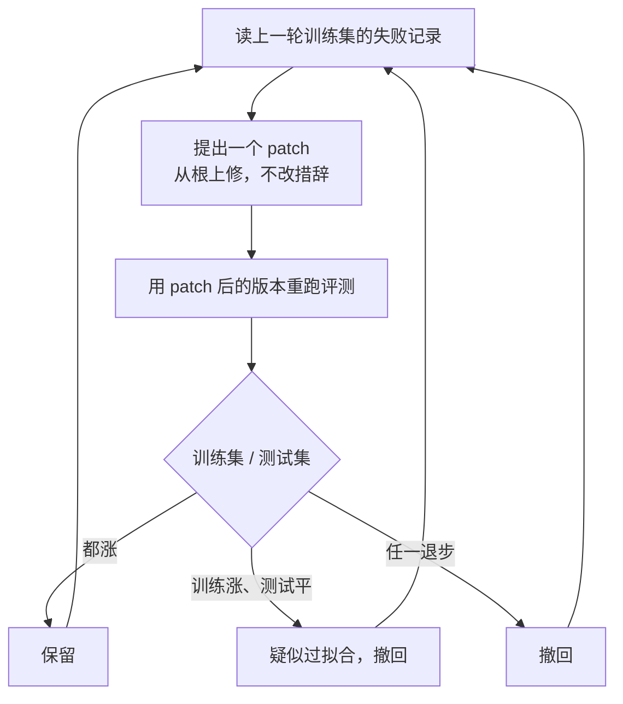

# 自动化评测设计与爬山优化：学习笔记

> 基于 claude.dev 工程博客文章《Automating eval design and hillclimbing with Claude》与 Claude Code 中 claude-api skill 的 `build-eval` / `hillclimb` 子命令整理。

---

## 0. 来源与关联

### 0.1 原始文章

| 项目 | 内容 |
|---|---|
| 标题 | Automating eval design and hillclimbing with Claude |
| 作者 | Lance Martin（Anthropic） |
| 发布时间 | 2026-09-28 |
| 发布位置 | claude.dev 博客，Playbooks 栏目 |
| 原文链接 | https://claude.dev/blog/automating-eval-design-and-hillclimbing/ |
| 阅读时长 | 约 12 分钟 |
| 致谢中提到的 skill 开发者 | Misha Khalman |

文章做了两件事：
1. 总结**设计评测**和**在评测上爬山优化**的原则，核心是"不要自己骗自己"；
2. 介绍 Claude Code 中 claude-api skill 新增的两个子命令，把这些原则变成自动化流程。

### 0.2 对应的工具：claude-api skill

| 项目 | 内容 |
|---|---|
| skill 名称 | `claude-api` |
| 仓库位置 | https://github.com/anthropics/skills/tree/main/skills/claude-api |
| 分发方式 | 随 Claude Code 一起分发，运行 `claude update` 即可获得最新版 |
| 相关子命令 | `/claude-api build-eval`（搭评测）、`/claude-api hillclimb`（爬山优化） |

**几个容易误解的点：**

- **claude-api 不是 CLI，也不是一种调用方式**，它是一个 skill。skill 本质上是一个文件夹，核心是一份 `SKILL.md` 说明文档，Claude 在需要时读入并照着执行。
- **名字的由来**：这个 skill 的主题是"如何用 Claude API 构建应用"（正确调用 API、SDK 用法、哪些写法已过时等）。build-eval 和 hillclimb 是这次新加进去的子功能。
- **`/claude-api build-eval` 的含义**：在 Claude Code 中用斜杠命令调用 `claude-api` skill，`build-eval` 是参数，指定走哪个子流程。真正干活的是 Claude Code 会话里的 Claude，它读了这份说明后按流程采访你、写代码、跑评测。
- **为什么归在 claude-api 下而不单独成 skill（个人推测，文章未说明）**：爬山能调的杠杆（模型选择、effort、prompt caching、参数兼容性）本身就是 API 知识，放在一起可以复用 skill 里已有的 API 知识，避免重复维护；目标用户就是用 Claude API 做应用的人；顶层 skill 越少，触发冲突越少。代价是可发现性下降，名字容易引起误会。

**计费分两层（一般结构，具体以官方说明为准）：**

| 层次 | 包含什么 | 走哪种计费 |
|---|---|---|
| Claude Code 会话本身 | 读 skill、和你对话、写评测代码、分析失败记录 | 你 Claude Code 的登录方式（订阅或 API key） |
| 评测实际运行 | 被测应用调用 Claude API、LLM 评委打分 | 被测应用自己配置的 API key，按 API 计费 |

文章里"每张工单 4.6 美分降到 1 美分"之类的成本，说的都是**被测应用**的 API 成本。

### 0.3 文章中引用的延伸阅读

- Anthropic 工程博客《Demystifying evals for AI agents》：https://www.anthropic.com/engineering/demystifying-evals-for-ai-agents （文章引用它来强调"信任评估器之前先读打过分的记录"）
- Claude 博客《Reducing cost and improving performance with Claude Platform》：https://claude.com/blog/reducing-cost-and-improving-performance-with-claude-platform （降成本的常见手段，客服案例的 benchmark 也出自这里）
- claude.dev 博客《Getting the most out of Opus 5.5》：https://claude.dev/blog/getting-the-most-out-of-opus-5-5/ （Opus 5.5 定价）

### 0.4 本笔记的阅读约定

- **【原文】** 标注的内容来自文章，均为意译和归纳，不是原文摘录。
- **【解读】** 标注的内容是学习过程中的理解、例子和推演，用于帮助吃透原文。
- **【批判性阅读】** 标注的内容是用文章自己的标准反过来审视文章的结果，原文中没有。
- 建议配合原文阅读，原文中的图（Fig 1 到 Fig 9）对理解很有帮助。

---

## 1. 全文主线

**核心矛盾**：评测是判断应用或 skill 在某类任务上表现如何的信号来源，但**设计评测本身很难**，而在评测上提分又很容易**自己骗自己**，即分数涨了，能力没涨。

**全文一句话**：评测要设计得让**分数变化 = 能力变化**；在评测上爬山时，要让**只有在没见过的题上也成立的改进**才能留下来。

**全文结构**：

```
原则层                         工具层
──────────────                ──────────────
好评测的设计原则        →      /claude-api build-eval
爬山原则 + 防过拟合     →      /claude-api hillclimb
                               ↓
                         两个实战案例
```

本笔记按"原则 → 工具 → 案例 → 延伸思考"的顺序组织。

---

## 2. 第一部分：好评测的设计原则

### 2.1 读懂 Fig 1：四个要素在一张图上长什么样

【原文】Fig 1 是一张示意图（不是真实数据）：
- 横轴：每次尝试消耗的 token 数（对数刻度）
- 纵轴：得分
- 三条线：大、中、小三个尺寸的模型
- 每条线三个点：low / medium / high 三档 effort
- 顶部一条"满分线"

【解读】一个健康的评测在这张图上应该表现为：
1. 大模型的线整体在小模型上面；
2. 每条线从左到右（effort 越高）都在往上走；
3. 最高的那个点离满分线还有一段距离；
4. 每个点的误差很小。

这四个视觉特征，对应下面的四条原则（第 1 条"像生产"是前提，图上体现不出来，图上标的是另外几条加上方差）。

---

### 2.2 要素一：题目要像真实生产场景

【原文】从你真正在乎的"生产"环境（即被测能力最终被使用的场景）中采样任务。有时人们会因为题目**好生成**或**好判分**而选它，但必须确保任务分布代表你**真正**在乎的东西。

【解读】这是最常见的偷懒方式。例子：做一个邮件分类器，真实邮件往往又长又乱，一封里夹杂多个诉求；但造题时人会倾向于写一句话就能看出类别的干净邮件，因为好写、标准答案明确。这样的评测分数再高，也说明不了真实场景下好不好用。

**关键词是"分布"**：不只是单道题像不像，而是整套题里各类任务的比例、难度、表达方式，是否和真实流量一致。

---

### 2.3 要素二：更强的模型、更多的思考，应该得分更高

【原文】能力更强的模型、更高的 effort 通常应该在评测上表现更好。如果不是，往往是题目有歧义或者打分器没校准，拖累了表现。

【解读】这条既是要求，也是**体检手段**。拿不同档位的模型和 effort 各跑一遍，如果曲线不单调，先回头查题和打分器。

两种常见原因：
- **题目有歧义**：题面没说清楚，强模型想得更多，考虑了另一种合理解读，结果和标准答案对不上，越聪明反而越"错"。
- **打分器没校准**：打分逻辑只认某种特定写法，强模型写了一个更好但形式不同的答案，被判错。

这个检查的好处是**不需要生产数据**，任何评测都能做。

---

### 2.4 要素三：顶部要有"合理的"提升空间

【原文】最强模型在最高 effort 下也应该明显低于 100%，否则无法可靠判断改动的影响。但这段差距**不能由无解或歧义的题目造成**。一个常见信号是：某道题无论重复多少次都失败。好题的标准是：两个领域专家会给出相同的判断，且打分器检查的所有内容在题面中都有说明。

【解读】

**为什么需要空间**：如果已经 98%，任何改动最多涨 2 个点，而这 2 个点很可能被随机波动淹没。这种状态叫**饱和**。

**为什么空间必须"合理"**：如果 30% 的题本身无解或有歧义，最强模型也只能到 70%，看上去空间很大，其实是假空间，怎么优化都上不去。

**识别坏题的信号**："永远失败"。正常的难题模型偶尔能做对，永远做不对的大概率是题本身有问题。

**好题的两层标准**：
1. 两个专家判断一致 → 题目没有歧义；
2. 打分器检查的一切都写在题面里 → 没有隐藏要求。

第二层特别容易踩坑。例如题目只说"写个函数处理这个错误"，打分器却检查"必须打日志、必须重试三次"，这就是打分器偷偷加了题面没说的要求。第 6.2 节的案例里真的遇到了这种情况。

---

### 2.5 要素四：多次运行的结果要稳定

【原文】高方差通常来自设计不良、有歧义的题目，或者对相同输出给出不同判定的打分器。方差也可能藏在配置里，比如 effort 没有被一致地应用。环境也会影响结果：上一轮试验残留的状态（某个文件、git 历史）可能直接把答案递给 agent。

【解读】方差来源可以归为三类：

| 来源 | 表现 |
|---|---|
| 题目模糊 | 模型每次读出不同意思，答案飘 |
| 打分器不稳定 | 同一输出这次判对、下次判错，LLM 评委尤其常见 |
| 配置与环境 | effort 参数没生效；沙箱没重置，agent `ls` 或 `git log` 一下就看到上一题的产物 |

方差大的直接后果：**改动带来的提升和随机波动分不清**。

**四个要素合起来只在保证一件事：分数的变化 = 能力的变化，而不是题目、打分器、环境的噪声。**

---

### 2.6 对抗式采样的陷阱

#### 前提：模型能力是"锯齿状"的

【原文】模型能力是参差不齐的（jagged）。

【解读】把所有可能的任务铺成一条横轴，纵轴是模型在每个任务上的能力，画出来不是平滑曲线，而是高低起伏的锯齿：有些任务意外地强，有些看似简单的任务莫名翻车。而且**每个模型的锯齿形状不同**，今天的模型在 A 处有坑，下一代可能 A 处已填平，却在 B 处出现新坑。

#### 问题：专挑模型做错的题

【原文】如果因为今天的模型做错而挑选题目，你采样的是这个模型能力曲面上的"谷底"。评测最终测量的是这个模型的**失败指纹**，而不是你的应用真正困难或有价值的东西。

Fig 2 左右对比：
- 左：按"今天模型的失败"采样，题目全部扎堆在今天模型的谷底；
- 右：由人判断难度来选题，题目分布在峰和谷各处，并包含少量"不该触发"的题。

【解读】这样做的四个后果：

1. **换模型时分数乱跳**：下一代模型坑的位置不同，可能一下把这批题全做对，分数从 20% 飙到 85%。你以为它在业务上强了很多，其实只是它恰好没有上一代那些坑，它自己的新坑评测一个都没覆盖。
2. **起点失真**：题全从失败里挑，baseline 天然接近 0，不代表应用很烂。
3. **优化方向被带偏**：围着这个模型的特定弱点打补丁，补丁对真实用户可能没用，换模型后甚至变成负担。
4. **分布不再像生产**：直接违反要素一。真实流量大部分是普通任务，评测却全是刁钻题。

一句话：**用模型的失败来定义"难"，等于让被测对象替你出题**，有循环论证的味道。

#### 正确做法

【原文】
- 由人判断题目难，一个有用的检验是：放进评测之前，你能说出它**为什么难**；
- 纳入你的应用在生产流量、bug 报告、工单中出现的具体失败；
- 但不要盲目相信用户流量：用户往往只尝试他们预期能成功的东西，完全从用户流量采样的任务分布可能**偏简单**。

【解读】

- **"能说出为什么难"**：例如"这封邮件同时涉及退款和账号安全，路由优先级要按规则判断"，这是有理由的难题。如果只能说"模型做错了"，它可能只是踩中了模型的某个坑，或者是坏题。
- **真实失败 vs 挑模型的失败**：前者是真实用户在真实场景遇到的问题，本身就代表你在乎的东西；后者是人为制造的考题。
- **用户流量偏简单是一种幸存者偏差**：用户用过几次后形成预期，不再尝试那些"不行"的需求。你看到的流量，是用户已经适应了产品能力边界之后的流量。

#### 补充：should-not-fire（不该触发）的题

【解读】Fig 2 右侧特意画了这类题，正文没展开。指的是"正确答案是**不应该**做某事"的题。比如一个 skill 应该在用户问 Claude API 时触发，评测里也要放一些"用户问的是别的，skill 不该触发"的题。只测正例，一个永远触发的 skill 也能拿满分，但实际体验很糟。

---

## 3. 第二部分：爬山的原则

### 3.1 "爬山"是什么

【解读】hill climbing 原本是优化算法中的经典方法。想象蒙着眼站在山地上，看不到全局地形，只能往某个方向试探一小步：变高了就留下，变低了就退回，然后再试下一步，直到往哪走都不再升高。

对应到本文：

| 爬山算法 | 本文中的含义 |
|---|---|
| 山的高度 | 评测分数（或你设定的目标，如成本） |
| 走一步 | 对 prompt、skill、参数等做**一个**改动 |
| 测高度 | 重新跑一遍评测 |
| 留下或退回 | 分数涨了保留改动，没涨撤销 |

在 AI 圈，"在某个 benchmark 上 hillclimb"泛指围绕一个评测反复迭代提分。

**三个需要理解的要点：**

1. **前提是尺子准**。如果连"脚下是变高还是变低"都测不准，这个方法就失效了。这就是为什么全文反复强调方差和置信区间。
2. **分数是代理指标**。评测只是真实场景的近似。专门针对一个指标优化，它就容易和真实目标脱钩，这就是**古德哈特定律**：一个指标一旦成了目标，就不再是好指标。例：评测第 7 题总挂，就往 prompt 里加一条只针对第 7 题情况的规则，分数涨了，但这条规则在真实流量里可能一年用不上一次，还可能干扰别的情况。
3. **会卡在局部最高点**。小步试探走到一个小山包，往哪走都不再升高，但旁边有座更高的山。hillclimb 命令里"停滞后归因"那一步，某种程度上就是在应对这个问题。

另外，**目标不一定是质量分数**，也可以是"在保持质量的前提下，成本有多低"。爬法一样，只是衡量标准变了。

【原文】爬山适合用来调那些在成本和效果之间做权衡的参数，比如 effort 或 prompt。

---

### 3.2 选什么来爬：三条原则

#### 原则一：改起来要便宜（Cheap iteration）

【原文】你聚焦的改动面（surface）修改起来应该在时间、成本、精力上都便宜。很多内部工作和客户把爬山集中在文本上，比如 prompt 和 skill，它们容易修改和撤回。相比之下，在爬山过程中对 agent harness 做开放式修改，可能涉及大量代码改动。

【解读】爬山每一步都是"改 → 跑评测 → 留或撤"，可能要跑十几二十轮，单步成本会被放大很多倍。

| 改动面 | 特点 |
|---|---|
| 改 prompt | 改动就是几行文字的 diff；撤回即还原；不会引入新 bug；副作用可控 |
| 改 harness 代码 | 牵涉多个文件；改动本身可能写出 bug，bug 又反映到分数上；分数掉了分不清是"思路不行"还是"实现写错"；撤回麻烦 |

改动面越"轻"，每一步的信号越干净。

#### 原则二：分数变化要能归因（Attributable）

【原文】评测分数的变化应该能归因到你正在修改的改动面。例如，好几个成功的爬山应用都聚焦在 skill 触发上：评测指标（skill 的触发率）和被修改的 skill 描述直接耦合。

【解读】Claude 决定是否加载一个 skill，主要看它的描述。所以改描述 → 触发率变；触发率变 → 原因几乎只可能是描述变了。**因果链只有一步。**

反例：指标是"一个很长的 agent 工作流最终是否完成任务"，改的是其中某个工具的描述。最终成败受几十个因素影响，你改的那一处影响可能被稀释到看不出来，或者和其他因素纠缠。分数动了不敢说是你的功劳，没动也不敢说改动没用。

**和噪声的关系**：改动面与指标耦合越紧，一次改动带来的分数变化越大，越容易**超出评测噪声**被测出来。归因性差的改动效应量小，容易淹没在置信区间里。

注意：这里的"skill 触发"是作者举的泛化例子，不是第 6 节的案例。

#### 原则三：目标要边界清晰（Well-scoped objective）

【原文】一个常见失败模式是：开放式地要求提升效果，却没有仔细考虑评测还剩多少提升空间。评测接近饱和，或者改动面定义得太宽泛（比如开放式地"更新 harness"），都更容易停滞。一个在各类工作中普遍很好的目标是**成本**：即使评测已经饱和，也可以让 Claude 在保持效果不变的前提下找办法降成本。

【解读】为什么成本是个好目标：

1. **几乎总有空间**。效果可能饱和，但很少有配置已经把成本压到极限：prompt 可能冗余、模型可能选大了、effort 可能开高了、缓存可能没用上。
2. **测量精确、噪声低**。token 数和价格是确定的数字，不像准确率有随机波动。
3. **手段明确**。换小模型、降 effort、开 prompt caching、删冗余指令，这些杠杆都是已知且改起来便宜的，符合原则一。
4. **"保持效果"本身就是一道防线**。不是无约束地降成本，而是有质量底线卡着，任何让效果掉的改动都撤回。

**三条合起来**：选一个改起来轻、改了能看出效果、目标明确的东西去爬，每一步的信号才干净。

---

### 3.3 过拟合：评测是怎么"渗"进系统的

#### 定义

【原文】即使设计良好的评测，也很少能完全匹配你在生产中关心的任务分布。因此对评测"过拟合"是常见问题，结果是系统在评测上的表现好于在生产流量上的表现。

#### 什么是 harness

【原文】harness 指模型周围的代码，包括 prompt、工具，以及调用 Claude 的那个循环。

爬山改的就是 harness，所以过拟合也体现为 harness 被改歪了。文章用的词是"泄漏"（leak）：评测的特征以各种方式泄漏进 harness。

#### 主例子：OCR

【原文】假设某个评测任务受益于 OCR，但 OCR 在你的生产任务里很少有用。爬山可能给应用加一个 OCR 工具，评测分数提升，但对生产毫无影响。更广泛地说，爬山可能往 harness 里添加功能，专门处理你所选评测题中的边缘情况。

#### Fig 5：五种泄漏，从隐蔽到明目张胆

| # | 评测的特征 | 导致的 harness 改动 | 说明（解读） |
|---|---|---|---|
| ① | 任务配比需要 OCR | 加一个 OCR 工具 | 评测的任务比例和生产不同，harness 会往评测偏重的方向长 |
| ② | 任务都在 `/app` 目录 | prompt 写"总是 cd /app，跑 pytest" | 把评测环境的偶然特征当成普遍规律；真实用户项目可能在任何目录、不用 pytest |
| ③ | 题目有独特措辞 | 针对这种措辞调过的 prompt | 最隐蔽，改动看起来就是"优化了一下表述"；换成真实用户的写法就打折扣 |
| ④ | 读过的失败 | 每个失败一个补丁 | 本质是背答案，补丁数随失败数线性增长，每个补丁只对一道题有用 |
| ⑤ | 公开仓库里有答案 | harness 直接 curl 参考解 | 图中用虚线标出，已经是直接作弊 |

【解读】前四种都**不是故意作弊**，每一步单看都很合理："加个工具""明确一下路径""调一下措辞""修一下这个 bug"。正因为合理，才难察觉。

#### 三道防线

**防线一：切分题目（Split the cases）**

【原文】用一个爬山可以读的训练集，和一个永远不被看到的测试集。如果训练集分数涨而测试集持平，这是常见的过拟合警告信号。

【解读】为什么有效：以第 ④ 种泄漏为例，补丁只对训练集里那道题有用，测试集的题没见过，补丁不起作用，测试集分数不动。两者一对比就暴露了。真正有普遍意义的改进，应该在两边**都**看到提升。

【批判性阅读】**切分的局限**：测试集只能抓到"对具体题目的过拟合"，抓不到"对整个评测分布的过拟合"。训练集和测试集从同一批题随机切出，分布相同。以 OCR 为例，如果整套评测都偏重 OCR，加了 OCR 工具后训练测试**两边都会涨**，切分识别不出来。这类问题只能靠前面的评测设计（要素一：分布像生产）来防。**评测设计和爬山防过拟合是两层保护，缺一不可。**

**防线二：绝不把失败内容贴进 prompt**

【原文】如果爬山读了失败记录，它绝不应该把失败的内容贴到 prompt 里。

【解读】专门对付第 ④ 种泄漏。比较两种修法：

| 修法 | 例子 | 性质 |
|---|---|---|
| 贴失败内容 | "如果用户说'我上个月被扣了两次 49 块钱'，应路由到账单组" | 背具体题目 |
| 提炼规则 | "涉及重复扣费的问题，路由到账单组" | 有普遍意义的规则 |

**自检方法**：改动里如果出现了某道题的具体细节，大概率是在背答案。

**防线三：从结构上让模型够不着答案**

【原文】模型有时会"奖励黑客"（reward hacking），直接找到评测的答案。

【解读】关键词是**结构上**（structurally）。不能靠在 prompt 里叮嘱"请不要找答案"，而要让答案**物理上拿不到**：
- 沙箱断开对答案仓库的网络访问；
- 答案文件不放在 agent 能读到的文件系统里；
- 每道题之间环境彻底重置。

这和要素四的"环境残留"是同一类问题。能力越强的模型越可能发现捷径，所以只能靠隔离，不能靠叮嘱。

---

## 4. 第三部分：`/claude-api build-eval` 详解

### 4.1 整体交互方式

【原文】运行 `/claude-api build-eval` 后，Claude 会采访你，在你的代码库里构建评测，并在特定节点暂停等待批准。

【解读】三个特点：
1. **先采访**：了解应用做什么、在乎什么；
2. **在代码库里直接搭**：不是给一份文档让你自己实现；
3. **关键节点停下等批准**：原则里好几条（分布像不像生产、难度是否合理、打分标准对不对）都需要领域判断，只有你知道，所以人被放在最需要人的地方。

### 4.2 找题：有明确的优先级

【原文】Claude 按以下顺序帮你采样输入：
1. 生产环境的运行记录（会先询问数据保留和敏感数据问题）；
2. bug 报告和支持工单；
3. 你手写的 5 到 10 个例子；
4. 从你的代码库合成的例子。

skill 优先使用生产流量，但也可以生成**锚定在你提供的少量真实例子上**的合成数据。

【解读】这个顺序就是第 2 节原则的直接落地，**越靠前越接近真实分布**：
- 生产记录就是生产本身，最真实；
- bug 和工单是真实发生过的失败，对应"从应用的真实失败里取材"；
- 手写例子带着你的领域判断，你知道什么难、为什么难；
- 从代码合成的最"人造"，排最后。

"锚定"的意思是：不凭空编，而是参照真实例子的风格、长度、复杂度去扩充，避免生成一堆干净整齐但不像真实情况的题。

### 4.3 题目审核页

【原文】skill 让 Claude 生成一个简单页面，展示每一条输入，等你确认。Fig 3 是一个邮件路由应用的例子：24 条输入，每条是一封邮件的文本，带 billing、easy、ambiguous 等标签；旁边聊天里 Claude 问"这些输入有代表性吗"，用户回答"是"。

【解读】
- **标签里有 ambiguous**：这不是把坏题放进去，而是真实邮件本来就有模糊的（比如既抱怨扣费又说登不上账号）。区别在于：真实的模糊邮件按路由规则应该有确定的正确去向；坏题则连专家都判断不出来。
- **逐条看而非只看统计**：落实"分布像生产"，只有你能判断这 24 封邮件像不像你每天真正收到的。

### 4.4 打分器：选最便宜但够用的

【原文】输入确定后，Claude 会提议适合你应用输出的**最便宜的打分器**。

#### 类型一：程序化校验

【原文】如果输出可能性有限，就用基于代码的检查：精确匹配、从固定集合中选标签、符合 schema 的 JSON、能通过的测试。

【解读】优先它的原因：**便宜、快、完全确定**。同一个输出永远得到同一个分数，直接消除了打分器自身的方差。**能用代码判就不用模型判。**

#### 类型二：LLM 当评委（LLM-as-judge）

【原文】输出空间开放（合理答案很多，但质量标准清晰）时默认使用。第二个模型读取输入、输出和一份写成**可检查陈述**的 rubric（而不是 1 到 5 分的量表），返回分数及理由。如果有 baseline 可比，评委改为以随机顺序读两份输出，不被告知哪份是 baseline，挑出更好的。评委模型由你选，且不应该是被测模型。

【解读】三个设计细节，各有门道：

**细节一：rubric 写成可检查的陈述**

不写"回复的礼貌程度打 1 到 5 分"，而写成：
- 回复中提到了退款将在几个工作日内到账；
- 回复没有承诺超出政策的赔偿；
- 回复给出了下一步操作。

原因：1 到 5 分很主观，"3 分和 4 分的区别"连人都说不清，模型评委每次给分会飘，引入方差。"是否提到了 X"的答案基本确定。这和"好题要让两个专家判断一致"是同一思路，只是用在了打分器上。

**细节二：有 baseline 时盲比**

针对 LLM 评委的已知偏差：
- **随机顺序**：对付位置偏差（倾向偏好排在前面或后面的那个）；
- **不告诉哪个是基线**：避免"新版应该更好"之类的预设。

**细节三：评委不能是被测模型**

对付**自我偏好**：模型倾向给自己风格的输出打高分。同一个模型既当选手又当裁判，分数会虚高。

### 4.5 校准打分器

【原文】Claude 先给少量题目打分，问你是否会给出不同的分数（Fig 4 是带建议分数的结果页示意）。总体而言，在相信评估器之前，阅读一批打过分的记录很重要；打分失败是评测配置错误最常见的方式之一。

【解读】打分器本身也是一个需要被测试的程序。写代码要写测试，打分器同样需要验证，而验证它的"标准答案"只能来自人的判断。要素二中"强模型分数不涨"的异常，根源常常就在打分器。

### 4.6 跑之前：告诉你规模

【原文】打分器验证后，skill 告诉你评测集的规模（题目数 $\times$ 重复次数 $\times$ 模型数，以及大致耗时），然后运行 baseline，打印带**置信区间**的分数。

【解读】
- **规模告知**：评测跑一次要花钱花时间。24 题 $\times$ 每题 5 次 $\times$ 3 个模型 = 360 次调用，agent 任务每次还可能跑好几分钟。先心里有数，可以决定减少重复次数或先只测一个模型。"重复次数"对应要素四：同一题多跑几遍才能看出方差。
- **置信区间**：单独一个"68.1%"无法使用。如果区间是 $\pm 2\%$，下次 72% 就是真进步；如果区间是 $\pm 8\%$，72% 可能只是运气。**没有置信区间的分数，在爬山时基本不能用来做决策。**

### 4.7 产出物

【原文】你拿到：题目、打分器、runner（运行器）、每道题一行 JSON 和一份完整运行记录、一个列出每题分数并链接到对应记录的朴素页面。想要更多（比如图表）可以直接要求，Claude 会另建页面。默认这些额外页面是本地打开的静态文件，不从网络加载任何东西。

Fig 4 的结果页：baseline 在 24 题上平均正确率 0.681，下方是逐题分数表，每次重复（rep）都有单独链接，点开能看到那次运行的原始 JSON 记录。

【解读】几个设计亮点：

1. **每题一行 JSON（JSONL）**：结构化、便于程序处理。想对比两个版本哪些题从对变错，直接 diff 两份 JSONL。后面 hillclimb 也是读这些记录来分析失败。
2. **分数一键直达原始记录**：直接服务于"一定要读打过分的记录"。分数和证据零距离，看到某题 0 分，点一下就知道模型输出了什么、评委为什么判错。如果还得去翻日志找对应记录，大部分人就懒得看了。
3. **页面故意朴素**：需要什么再加。
4. **本地静态、不联网**：运行记录很可能包含生产数据（找题第一步就来自生产记录），可能有真实用户的邮件内容。静态离线页面保证这些数据不会因为引用了外部脚本或字体而发到别处。

### 4.8 三项自动诊断

【原文】在 baseline 运行期间，Claude 检查：
- **打分器**：对同一输出运行两次打分器，报告判定是否改变；
- **管道（plumbing）**：检查超时、API 错误和被截断的回答，确保基础设施噪声不会被当作模型方差；
- **提升空间**：如果 baseline 已约 95% 或更高，skill 会警告，提示爬山应转向探索成本或延迟而非质量。

【解读】

**诊断一：打分器一致性**。主要针对 LLM 评委（程序化打分器不会变）。妙处在于**把打分器噪声和模型噪声分开**：只看最终分数波动，分不清是模型每次答得不同，还是打分器每次判得不同；固定输出、只重跑打分器，就把变量隔离出来了。判两次结论不一致，说明 rubric 不够"可检查"，或题目本身模糊。

**诊断二：管道问题**。这个坑非常常见：

| 问题 | 如何伪装成模型问题 |
|---|---|
| 截断 | max_tokens 设小，模型写到一半被切，打分器判错，看起来像模型没答好 |
| 超时 | 高 effort 思考更久，更容易撞超时；若超时记为失败，会出现"高 effort 反而更低"，违反要素二，你可能错误得出"高 effort 没用" |
| API 报错 | 限流、偶发服务错误被算作答错，凭空制造方差 |

这些问题会让分数看起来"有道理"但其实是错的。

**诊断三：提升空间**。要素三的自动化版本。95% 时剩下 5% 里可能还有坏题，真实可提空间很小，很可能落在置信区间内。与其硬磕质量，不如换目标：保持质量，能不能更便宜、更快。

### 4.9 build-eval 小结

```
找真实的题 → 你确认题 → 选最便宜可靠的打分器 → 你校准打分器
→ 告知规模 → 跑 baseline（带置信区间）
→ 自动排查：打分器不一致 / 管道噪声 / 已饱和
```

每一步都在防"自己骗自己"。

---

## 5. 第四部分：`/claude-api hillclimb` 详解

### 5.1 你来划定能改什么

【原文】你选择 Claude 可以修改的内容，包括：
- system prompt
- skill 或指令文件
- 工具描述
- 模型选择、effort 档位及其他 API 参数
- harness 代码

【解读】列表大致**从轻到重**排列，对应原则一"改起来便宜"。由你勾选范围，本身就是在落实原则三"目标边界清晰"：不开放 harness，它就不会去碰。

### 5.2 问目标、切分数据

【原文】开始前，Claude 询问你要优化什么（例如效果，或在效果保持的前提下降成本），然后把评测集**随机**切分为测试集和训练集。如果目标是成本，它会考虑几个常见的成本驱动因素：prompt caching、审计 prompt 与所选模型的兼容性、选择模型和 effort。

【解读】
- **"随机"很重要**：手动挑可能无意识地把简单题放一边、难题放另一边，两边分布不同，比较就没意义了。
- **三个成本杠杆**：

| 杠杆 | 含义 |
|---|---|
| prompt caching | 重复的长前缀（如很长的 system prompt）缓存起来，读缓存比重新输入便宜得多 |
| prompt 与模型兼容性审计 | 旧模型时代写的 prompt 常有为弥补模型能力而加的冗余指令，新模型不需要，白耗 token，甚至起反作用 |
| 模型与 effort 选择 | 最直接的杠杆 |

这三个在第 6.1 节客服案例里全都用上了。

### 5.3 开爬前：噪声预检

【原文】第一轮之前，Claude 检查评测的**噪声**（分数仅因偶然就可能移动的幅度）是否小于你愿意采取行动的最小提升；如果不是，它会说明，并建议增加重复次数或题目。

【解读】例子：你认为"提升 3 个点才值得改代码"，但评测随机波动就有 $\pm 5$ 个点。那么：
- 真带来 3 个点提升的改动会被噪声淹没，测不出来；
- 毫无作用的改动可能运气好显示涨了 4 个点，被错误保留。

这种状态下爬山等于在噪声里随机游走。

缩小噪声的两种方法：
- **加重复次数**：每道题的分数更稳定；
- **加题目**：总体平均值更稳定。

**本质：出发前先确认尺子够精确。**

### 5.4 每一轮的循环（Fig 6）

【原文】每一轮，Claude 读取上一轮的训练集运行记录，以 patch 形式提出**一个**改动。它把每轮瞄准在效果能高于评测噪声的改动上：从根源修复失败行为（比如重写导致问题的段落，或补一条缺失的规则），而不是改写某一行措辞。然后用打了 patch 的版本运行评测，并检查：训练集提升但测试集持平 → 怀疑过拟合，撤回；出现退步 → 撤回；训练集和测试集都提升 → 保留。Fig 6 标明分析器**只读训练集的失败**。



| 训练集 | 测试集 | 处理 |
|---|---|---|
| 涨 | 涨 | **保留** |
| 涨 | 持平 | 疑似过拟合，**撤回** |
| 任一边退步 | | **撤回** |

【解读】

**为什么只读训练集**：测试集一旦被读，就失去了"没见过的题"的意义，无法再检测过拟合。

**为什么每轮只改一处**：为了归因。一轮改三处，分数涨了不知道是哪个起作用；分数没变，可能是一正一负相互抵消。

**为什么要"从根上修"而不改措辞**：
- 改措辞的效果通常很小，大概率落在噪声范围内，等于白跑一轮评测、白花一轮钱；
- 反复改措辞容易变成随机游走：换个说法涨一点，再换又掉一点，其实都是噪声，却会让你误以为找到了规律。

这和噪声预检配套：**先确认尺子的精度，再确保每一步的步子大到尺子量得出来。**

**留撤规则的效果**：只有在没见过的题上也起作用的改动才能活下来，"背答案式"改动被系统性过滤。

#### 【批判性阅读】测试集其实被当成了验证集

测试集虽然从不被**读**，但它参与了**决策**：每一轮"留还是撤"都参考了测试集分数。在机器学习里，严格来说这种用于做选择的集合叫**验证集**，真正的测试集应该连决策都不参与，只在最后看一次。

影响：爬 20 轮，每轮都看测试集决定去留，最后留下的改动某种程度上是"碰巧在测试集上表现好"的那批。轮次越多，这种选择偏差越明显，最终报告的测试集分数可能**略偏乐观**。

这在实际工程中是合理取舍：题目本来就不多，再切出第三份会让每份都太小、噪声太大。但看最终分数时要心里有数。**更严谨的做法**：额外留一小份题目，整个爬山过程完全不碰，最后再测一次。

### 5.5 停滞时：停止改动，转为归因

【原文】当分数停滞两到三轮，Claude 逐一阅读剩下的每个训练集失败，按原因分类。如果没有任何单个修复能获得超过评测噪声的提升，它也会**提前**这样做，并建议增加重复次数或题目，而不是把轮次花在小到无法测量的改动上。这一步可以发现有歧义的评测题、harness 错误或运行间方差。只有真实的失败会进入后续爬山轮次。

【解读】

**为什么要换模式**：正常轮次本质是**贪心**的，每次抓最显眼的一个问题修。早期很有效，但修到后来，剩下的失败往往不再是"同一类问题的多个实例"，而是五花八门的零散问题，甚至根本不是能力问题。继续一个个修就是原地打转。退一步把所有失败摊开看，才能看清卡在哪里。这是对"局部最高点"的应对。

**这一步能揪出的三类非能力问题**：

| 类型 | 表现 |
|---|---|
| 有歧义的评测题 | 题目没说清楚，怎么改 prompt 都没用 |
| harness 错误 | 比如工具调用代码有 bug，模型怎么答都失败 |
| 运行间随机波动 | 题目时好时坏，这一轮恰好失败，不是系统性问题 |

**为什么一定要剔除非能力问题**：假设一道题的打分器写错了，要求的答案其实是错的。如果它留在失败列表里，Claude 会持续尝试"修复"它，修不好，最后可能往 prompt 里加一条规则，让模型**专门迎合这个错误的打分器**。分数涨了，应用却被教坏了。**坏题不仅浪费轮次，还会主动制造过拟合压力。**

这一步就是在系统化执行要素三的"永远失败"信号检查。

**提前触发条件的数字例子**：训练集 30 题，剩下的失败都是独立零散问题，修好任何一个最多涨 $1/30 \approx 3.3$ 个点。评测噪声 $\pm 5$ 个点，修对了也测不出来。此时继续爬山就是花钱跑注定测不出结果的实验，应该先把尺子磨精确。

**和噪声预检的关系**：开爬前检查"整体能不能测出提升"；这里检查"剩下这些问题还能不能测出提升"。爬到后期，可提升的空间越来越碎，原本够用的精度可能就不够了。

### 5.6 收尾交付

【原文】爬山结束时，Claude 把你的代码留在**在测试集上对你的目标表现最好**的版本，报告测试结果与 baseline 的对比及置信区间（Fig 7）。如果提升在噪声范围内，它会如实说明，并建议不要合并。

【解读】
- **停在最好的版本，而不是最后一个版本**。如果第 8 轮后的改动都没带来提升，就停在第 8 轮的状态。目标是降成本时，"最好"指在效果不掉前提下最便宜的。
- **提升在噪声内就建议别合并**：自动优化工具最自然的倾向是"展示成果"，跑了一堆轮次总得交出点什么。但噪声内的提升合并进去，等于往代码库加一堆无法证明有用的改动，还增加维护负担。坦白说"这次没有可靠进步"，比交一份看似漂亮的报告更有价值。

### 5.7 Fig 7：一个过拟合被拦截的实例

【原文】邮件路由例子爬山后的报告页，比较三个版本在训练集和测试集上的分数（baseline 为 0.681）：
- **v1**：给每个路由队列下定义，并加一条冲突判定规则（tie-break rule）。标为最佳，训练集和测试集都是 0.875。
- **v2**：在此基础上加两个完整示例（worked examples）。训练集上涨，测试集持平，被撤回。

【解读】这是"提炼规则 vs 背具体题目"的真实写照：

- **v1 提炼规则**："每个队列负责什么""冲突时怎么判"是对任何邮件都适用的知识，所以训练测试**同步上涨**，幅度相同。
- **v2 加示例**：爬山只能读训练集失败，写的示例很可能照着训练集里那几封难搞的邮件写。模型在训练集里**相似的题**上做对了，但测试集的题没见过，示例帮不上忙。

需要注意：这**不代表加示例本身不好**，few-shot 示例在很多场景都很有用。关键在于这个判断**不靠人的经验或直觉，而由数据做出**。哪怕人觉得"加两个例子肯定更好"，数据说不是，那就不是。

### 5.8 hillclimb 小结

```
划定改动范围 → 问目标、随机切分 → 噪声预检
→ 循环：只读训练集失败 → 改一处、从根上修 → 训练测试同涨才保留
→ 停滞（或剩余修复测不出）时：转为归因，剔除坏题 / harness 错误 / 噪声
→ 停在测试集最佳版本，带置信区间报告，提升在噪声内则建议不合并
```

---

## 6. 第五部分：两个实战案例

> 两个案例展示的都是 **hillclimb**。文章没有说明这两个评测是用 build-eval 搭建的。

### 6.1 案例一：客服评测降成本

#### 背景

【原文】Anthropic 在一个内部客服 benchmark 上运行 `/claude-api hillclimb`，目标是降低成本并提升效果。benchmark 共 44 张工单，30 张用于搜索（相当于训练集），14 张留出（测试集）。起点：Opus 4.8，默认（高）effort，搜索集决策准确率 74.4%，每张工单 token 成本 4.6 美分。

【解读】"决策准确率"指客服 agent 对每张工单的处理决定是否正确（该不该退款、转给哪个部门、要不要升级）。结果较确定，适合程序化判分。

Fig 8 把过程画成一条路径：横轴为每张工单成本（对数刻度），纵轴为准确率。理想移动方向是**往左上走**：更便宜、更准确。

#### 完整路径

| 步骤 | 配置 | 搜索集准确率 | 每单成本 |
|---|---|---|---|
| 1 | Opus 4.8，高 effort（baseline） | 74.4% | 4.6¢ |
| 2 | 审计后的 prompt + Opus 5.5，低 effort | 87.8% | 1.9¢ |
| 3 | 同一 prompt + Sonnet 5，低 effort | 88.9% | 约 1¢ |
| 4 | 改进后的 prompt + Sonnet 5，低 effort | 98.9% | 约 1¢ |

#### 第一步：审计 prompt，然后换模型

【原文】爬山先审计 prompt，删除了：强制性的工具调用"仪式"、一个 scratchpad 步骤、相互矛盾的规则。然后尝试 Opus 5.5 低 effort，超过了 baseline 的准确率门槛，达到 87.8%，成本降到 1.9 美分，不到起点的一半。

【解读】删掉的三类东西：

| 删除内容 | 是什么 | 为什么浪费 |
|---|---|---|
| 工具调用"仪式" | prompt 规定"处理任何工单前，先调查询客户信息工具，再调查询订单历史工具"之类的固定流程 | 很多工单用不上，每次多余调用都是一轮往返和一堆 token |
| scratchpad 步骤 | 要求模型"先在某标签里写下思考过程再作答" | 早期模型的技巧；现在模型自带思考，再显式写一遍等于重复思考，且按输出价格计费 |
| 矛盾的规则 | 不同人在不同时间加的、互相冲突的条款 | 让行为不稳定；高 effort 下模型还会花大量思考去调和矛盾 |

**共同点**：大多是为弥补旧模型不足而加的，模型升级后成了包袱。这就是 5.2 节"审计 prompt 与模型兼容性"的具体内容。

**反直觉之处：effort 从高降到低，准确率反而大涨**。这和要素二"更多思考应得分更高"不矛盾。那条原则说的是**同一配置下** effort 越高越好；这里同时换了更强的新模型、删了冗余 prompt，低 effort 已经够用。降成本的思路本来就是"**给到够用**"，而不是"给到最多"。

【批判性阅读】Fig 8 中第 2 个点同时标注"审计后的 prompt"和"Opus 5.5 低 effort"，即 74.4% → 87.8% 是**删冗余 + 换模型**叠加的结果，文章没有拆开说各自贡献多少。这与"每轮只改一处"的原则有张力，可能是叙述时把几轮合并了，也可能实际如此，文章没细说。

#### 成本是怎么降下来的

【原文】部分节省来自 Opus 5.5 的定价：输入和输出 token 比 Opus 4.8 便宜 20%，缓存读取便宜 60%。

【解读】**总成本 = 用量 $\times$ 单价**，两头都在压：
- **用量少了**：低 effort 思考更少，删掉的仪式和 scratchpad 也省了一大块；
- **单价低了**：新模型单价更低，缓存读取尤其便宜。

#### 第二步：过了门槛就再降一档

【原文】因为 Opus 5.5 越过了门槛，爬山接着降一个模型档次，检查更便宜的模型是否也能过关。Sonnet 5 低 effort 得分约 88.9%，成本约一半，即每单约 1 美分。

【解读】策略可概括为：**先找到一个能过门槛的配置，过了就往便宜方向试，直到再往下就过不了为止**。这和爬山逻辑完全一致，"高度"换成了"便宜程度"，"不能掉下悬崖"的约束是准确率不低于门槛。也体现了原则三：降成本手段明确，每一步效果容易测（成本是确定数字，准确率只需看过没过门槛）。

#### 第三步：回头提效果

【原文】最后 Claude 用路由规则和退款上限的交叉引用改进了 prompt，使 Sonnet 5 达到 98.9%，成本基本不变。

【解读】
- **路由规则**：明确什么样的工单怎么处理、送往哪里；
- **退款上限交叉引用**：推测是在做退款决策的地方显式引用退款上限政策，让模型对照上限做决定。

加的都是**规则**，不是示例，与 Fig 7 的教训一致。

#### 最关键的数字：留出集

【原文】在搜索从未见过的 14 张留出工单上，最终配置得分 90.5%，原始配置为 78.6%，成本约为五分之一。

【批判性阅读】对比两组数字：

| | 搜索集 | 留出集 |
|---|---|---|
| 原始配置 | 74.4% | 78.6% |
| 最终配置 | 98.9% | 90.5% |
| 提升 | +24.5 | +11.9 |

搜索集涨近 25 个点，留出集只涨约 12 个点，**幅度差了一倍**。这印证了：
1. **搜索集分数天然偏乐观**：改动是盯着这 30 张票的失败做的，在它们身上效果最好。98.9% 不能当真实水平看。
2. **选择偏差**：留出集若参与了留撤决策（见 5.4 节），90.5% 也可能略偏乐观。
3. **样本很小**：14 张工单，一张约占 7 个点，置信区间相当宽，文章此处未给区间。

这些不影响"成本降到约五分之一、效果没掉且有提升"的核心结论。但它是一个阅读习惯：**看爬山结果时，永远盯留出集的数字，并问一句样本有多大。**

#### 案例一的教训

- 旧 prompt 里为弥补旧模型而加的东西，会成为新模型的包袱；
- 降成本是"给到够用"而非"给到最多"；
- 成本 = 用量 $\times$ 单价，两头都能压；
- 先过门槛，再往便宜方向逐档试；
- 提效果时加规则，不加照着失败写的示例。

---

### 6.2 案例二：用 hillclimb 优化 claude-api skill 自己

#### 背景

【原文】claude-api skill 提供使用 Anthropic API 的指导和与 Claude 协作的通用技巧（包括本文讨论的子命令）。Anthropic 希望确保这个 skill 能正确实现使用其 API 的代码，于是从文档派生出一套评测集来测试它。skill 起点为 66%。他们给爬山开放了**文档和 SDK** 的访问权限，让 Claude 能识别错误并自我纠正。

【解读】
- **注意这不是 skill 触发率的优化**。指标是 Claude 加载 skill 后写出的 API 代码的**通过率**。3.2 节提到的"skill 触发"只是作者举的泛化例子。
- **"套娃"结构**：hillclimb 是 claude-api skill 的一部分，这次爬山的对象恰好是 claude-api skill 自己。
- **开放文档和 SDK 为什么关键**：爬山的分析器要判断"代码错在哪、正确写法是什么"。如果只能凭自己的记忆，它的判断可能和 skill 里的错误一样过时。有了文档和 SDK 作为**事实依据**，它才能分辨谁对谁错。这在第三阶段起了决定性作用。

#### Fig 9：三阶段曲线

【原文】横轴为爬山轮次（0 为 baseline，到第 24 轮），纵轴为通过率。曲线上的点依次为：66.1% → 74.3% → 74.0% → 77.5% → 77.2% → 80.1% → 84.0% → 87.9%。三个阶段：
1. 补充缺失章节和类型表；
2. 修正 skill 指导 Claude 写代码的方式；
3. 修正打分器，并做更多 skill 编辑。

【解读】注意 74.3 → 74.0、77.5 → 77.2 这样的**小幅回落和平台期**。平台就是"连续几轮无进展"的地方，也是触发归因模式的时机。74.3 → 74.0 这种微小下降，本身就是噪声的样子。"别被噪声骗了"在真实曲线上就长这样。

#### 第一阶段：补内容（66% → 约 77%）

【原文】Claude 发现 skill 缺少对 8 个功能的覆盖，补充章节后提升到 74%。接着发现 C# 和 Java 类型表中的错误，修正后到 77%。

【解读】最直接的"知识补缺"，符合 hillclimb 正常轮次的模式：每轮找最常见的失败，从根上修，一次一处。类型表大概是"在某语言的 SDK 里，某概念对应的类名或字段类型"，表错了，写出的代码会编译不过或用错类型。

#### 停滞后的归因

【原文】分数停滞两轮后，Claude 分析剩余失败并按根本原因分类。正常一轮针对最常见的失败做一处编辑；这一步不做编辑，只把每个剩余失败按原因归类。这个反思步骤在几个方面很有用。

#### 第二阶段：内容明明在，Claude 却不用（约 77% → 80%）

【原文】跨失败反思后，爬山发现 skill 内容其实已经存在，但 Claude 仍在写旧版 API 形式（源自训练先验）。为此在 skill **顶部附近**加了一张表，把 Claude 记忆中的写法引导到当前写法。例如：从使用固定 token 预算的 extended thinking（新近的 Opus 模型 API 已拒绝这种写法）改为 adaptive thinking；从旧版 web search 和 web fetch 工具改为当前版本。它还把 C# 和 Java 中"不要用固定预算思考"的警告移到了对应 adaptive thinking 示例**之前**。通过率提升到 80%。

【解读】这是全文最有价值的发现之一。

**为什么会这样**：模型训练数据里有大量旧版 API 代码，教程、示例、项目大多是旧写法，这个先验很强。skill 里的新写法只是上下文中的一段文字。**当先验和上下文冲突时，上下文不一定赢**，尤其当那段内容埋在 skill 中间某处时。

**修复的三个层面：**

| 层面 | 做法 | 原理 |
|---|---|---|
| 位置 | 放到 skill 最上方 | 越早进入注意力，在开始写代码前就已被"提醒" |
| 形式 | "旧 → 新"对照表 | 普通写法"正确用法是 Y"挡不住脑中自动冒出的 X；对照表写的是"如果你想写 X，改成 Y"，直接拦截先验 |
| 顺序 | 警告放在示例之前 | 模型顺序阅读；先看示例可能已经开始沿用某些模式，警告来得太晚 |

**普遍意义**：写 prompt 或 skill 时，问题不只是"信息有没有写进去"，而是"**写进去的信息能不能打赢模型的先验**"。对于模型训练时见过大量旧版本的领域，光写新内容不够，要显式拦截旧习惯，而且位置和顺序都有讲究。

**这个洞察只能从跨失败的整体分析中得出**：单看一个失败，你会以为"skill 里没写这个功能"，一查发现明明写了，就卡住了。只有把一批失败放在一起，才能看出"内容在、但被先验压过"的共同模式。这就是停滞后转为归因的价值。

#### 第三阶段：揪出坏题（80% → 约 88%）

【原文】在补齐明显内容缺口后仍从未提升的题目，说明例子或打分器有缺陷。一道题要求代码捕获一种错误类型，而打分器要求至少三种组成的链，Claude 改写了题目。另一个打分器的指示与文档矛盾，用真实 API 测试表明文档是对的。解决这些问题，加上更多 skill 编辑，通过率到约 88%。

【解读】

**坏题一：题目和打分器要求不一致**。违反要素三的好题标准"打分器检查的一切都要写在题面里"。处理方式是**改题，不是改 skill**。如果去改 skill，让 Claude 总写三层错误链来迎合打分器，就是 5.5 节说的"坏题制造过拟合压力"，把应用教坏了。

**坏题二：打分器和文档矛盾**。两份资料打架时，不去猜哪个更权威，而是**直接拿真实系统做实验**。这也是开头"开放文档和 SDK 访问"的设置发挥作用的地方。

#### 【批判性阅读】

1. **66% → 88% 并不全是 skill 的进步**。第三阶段标注为"修正打分器，加上更多 skill 编辑"。修正打分器后的上涨，有一部分是**尺子被校准了**，原本被错判的正确答案现在判对了，而不是 skill 变好了。反过来，起点 66% 也是用有 bug 的打分器测的，真实起点可能略高。文章没有拆开这两部分，22 个点里能力提升和测量修正各占多少，无法区分。
2. **没有给留出集数据**。案例一明确报告了 14 张留出工单的结果，案例二只给了一条曲线，没提训练测试切分和留出集分数。按文章自己的标准，应该追问：没见过的题上表现如何？

这两点不是挑刺，而是**用文章教的方法去读文章自己的结果**。

#### 案例二的教训

- 给优化过程提供事实依据（文档、SDK、真实 API），它才能判断对错；
- 信息写进去 $\ne$ 能打赢先验，位置、形式、顺序都要设计；
- 跨失败的整体归因能发现单个失败看不出的模式；
- 题目和打分器冲突时改题不改系统；资料冲突时用真实系统做实验；
- 修评测带来的分数上涨要和能力提升分开看。

---

## 7. 延伸思考一：人和自动化的分工

整个流程**执行几乎是全自动的，判断不是**。人卡的节点，恰好是机器最难替代的地方。

### 7.1 人在哪些节点介入

**build-eval 中：**

| 节点 | 人做什么 |
|---|---|
| 开头采访 | 说明应用做什么、在乎什么，决定"好"的定义 |
| 提供题目来源 | 给生产记录、工单的权限或指路；决定隐私和数据保留；手写 5 到 10 个例子 |
| 审核题目 | 逐条确认"这像我的真实场景" |
| 选评委模型 | 用 LLM 评委时选哪个模型 |
| 校准打分器 | 看 Claude 打的几道题，指出会判得不一样的地方 |

**hillclimb 中：**

| 节点 | 人做什么 |
|---|---|
| 划定改动范围 | 开放 prompt，还是连 harness 一起开放 |
| 定目标 | 提效果，还是保效果降成本 |
| 噪声不够时补数据 | 加重复可自动，加题往往需要人提供真实样本 |
| 是否合并 | Claude 给建议，决定权在人 |

**自动化的部分**：写 runner、跑评测、算置信区间、三项诊断、随机切分、每轮读失败提 patch、按规则留撤、停滞时归因、出报告页面。

### 7.2 题目选取不是全自动的

找题的优先级前三位（生产数据、工单、手写例子）都是人产生的；合成数据排最后，且要锚定在真实例子上。第 2 节的原则也是"难度由人判断，并且能说出为什么难"。**题目的来源和分布靠人，Claude 负责收集、整理、扩充。**

### 7.3 一条分工原则

- **人负责"什么是好"和"要不要上"**：题目分布像不像真实场景、打分标准对不对、允许改什么、结果值不值得合并。
- **Claude 负责"怎么变好"和"好了多少"**：提改动、跑实验、算统计、按规则筛。

原因：后者有明确规则和可计算的信号；前者需要业务理解，而且一旦错了，后面所有自动化都在高效地往错误方向跑。

### 7.4 风险最高的一步：修改评测本身

案例二中，Claude 在爬山过程中改写了题目、发现了打分器和文档的矛盾。文章没说明这些对评测本身的修改是否需要人批准。

**这是整个流程中风险最高的一步，因为它改的是尺子本身。改代码改错了，评测会告诉你；改评测改错了，就没有东西能告诉你了。**

建议：Claude 可以**提议**修改评测，但修改评测这件事一定要人过目。

---

## 8. 延伸思考二：没有生产数据时，爬山还有意义吗

典型场景：开源项目，没有生产数据，也没有人力去打标。

**结论：有意义，但要调整预期。爬山的主要价值从"提分"转向"找问题和防退化"。**

### 8.1 风险在哪

没有真实数据时，评测分布是你**想象出来的**用户分布。训练测试切分只能抓"对具体题目的过拟合"，抓不到"对整个评测分布的过拟合"（见 3.3 节）。分布偏了，爬山会高效地把系统往你想象的方向优化，测试集也一起涨，你还察觉不到。

### 8.2 开源项目其实有替代数据源

回看找题优先级，第一位没有，后面几位开源项目反而有优势：

| 替代来源 | 说明 |
|---|---|
| GitHub issues | 就是 bug 报告和工单（优先级第二位），而且自带"标注"：用户已经说明了"哪里坏了、预期是什么" |
| git 历史 | 免费的带标签题库，尤其适合编程类工具。找一个修过的 bug，回退到修复前的状态当题目，修复时加的测试当打分器。这基本就是 SWE-bench 类评测的做法 |
| 自己的使用记录 | 开源作者往往也是重度用户，日常使用中遇到的失败随手记下，就是最接近真实的题目 |
| 手写 5 到 10 个例子 | 文章明确支持，成本很低，再以它们为锚去合成扩充 |

### 8.3 降低打标成本：选能程序化判分的目标

人力打标贵，是因为每道题都要人判。如果打分器是代码，"标签"就写在检查逻辑里了。没有人力时，**优先挑能用程序判分的改动面**去爬：

- 编程任务 → 用测试判；
- skill 触发 → 用"该触发 / 不该触发"判，正例反例都容易批量造；
- 输出格式合规 → 用 schema 判；
- 保效果降成本 → 成本是精确数字，只需一个够用的质量门槛。

这些目标耦合紧、可归因，需要的题目数量也少。

### 8.4 爬山的角色要变

- **当回归防线**：改 prompt、换模型、升级依赖后跑一遍，确保没把原来能做的事搞坏。这个价值不依赖分布完美。
- **当诊断工具**：案例二最有价值的产出不是那几个百分点，而是发现了"内容在但被先验压过"和两道坏题。这类洞察在小评测上一样能拿到。
- **保守接受改动**：只接受规则类、有普遍道理的改动；轮次别太多；涨了也当"待验证的假设"，而非确定的进步。
- **用要素二做体检**：换强模型、加 effort 看分数是否单调上升。不需要生产数据，却能发现题目歧义和打分器问题。

### 8.5 让评测活着

没有生产数据时，评测不该是一次性搭好的东西，而是**随项目一起长**的：每次 issue 报来一个真实失败就加进去，每次自己踩坑也加进去。一开始分布不准，但会越来越接近真实，爬山的可信度也随之上涨。

### 8.6 诚实的边界

如果你**完全不知道**用户实际拿你的东西干什么，再精巧的评测也补不上这个信息缺口，爬出来的分数反而会给你虚假的信心。这种情况下，与其花力气爬山，不如先建立反馈渠道，让真实的失败能流回来。

---

## 9. 实践检查清单

> 用于自己动手时逐项对照。可以直接用 `/claude-api build-eval` 和 `/claude-api hillclimb` 执行，这份清单帮助你在关键节点做出正确判断。

### 9.1 搭评测时

- [ ] 题目来源优先真实数据：生产记录 > bug / issue / 工单 > 手写 > 合成
- [ ] 合成数据是否锚定在真实例子上
- [ ] 逐条看过题目，分布像不像真实使用场景
- [ ] 每道"难题"都能说出为什么难，而不是"因为模型做错了"
- [ ] 包含"不该触发 / 不该做"的反例
- [ ] 题面写明了打分器检查的所有内容
- [ ] 能用程序判分的，没有用 LLM 评委
- [ ] LLM 评委的 rubric 是可检查陈述，不是 1 到 5 分
- [ ] 评委模型不是被测模型；有 baseline 时盲比、随机顺序
- [ ] 亲自读过一批打过分的记录，确认打分器判得对
- [ ] 每道题之间环境彻底重置，答案在结构上不可达
- [ ] 换强模型 / 加 effort，分数是否单调上升
- [ ] 同一输出判两次，结论是否一致
- [ ] 排查过超时、API 报错、截断
- [ ] baseline 带置信区间；是否已接近饱和（约 95%）

### 9.2 爬山时

- [ ] 改动面足够"轻"（优先 prompt / skill / 工具描述 / 参数）
- [ ] 改动面与指标耦合紧，可归因
- [ ] 目标清晰；评测饱和时改为"保效果降成本"
- [ ] 训练测试随机切分；测试集从不被读
- [ ] 开爬前确认噪声小于愿意行动的最小提升
- [ ] 每轮只改一处，从根上修，不改措辞
- [ ] 改动中没有出现某道题的具体细节（没有背答案）
- [ ] 训练测试同涨才保留；训练涨测试平即撤回
- [ ] 停滞时先归因，剔除坏题、harness 错误、随机波动
- [ ] 修改评测本身的提议由人审核
- [ ] 最终看留出集分数，问样本有多大
- [ ] 提升在噪声内则不合并
- [ ] 若条件允许，另留一份全程不碰的题做最终检验

---

## 10. 术语表

| 术语 | 含义 |
|---|---|
| eval（评测） | 衡量应用或 skill 在特定任务上表现的一组题目 + 打分方式 |
| grader（打分器） | 判断输出对错或好坏的程序或模型 |
| LLM-as-judge | 用另一个模型当评委打分 |
| rubric | 评分标准；本文主张写成可检查的陈述 |
| harness | 模型周围的代码：prompt、工具、调用循环 |
| surface（改动面） | 爬山时允许修改的对象 |
| effort | 模型思考力度档位（low / medium / high） |
| headroom（提升空间） | 最强配置与满分之间的差距 |
| saturation（饱和） | 分数接近满分，改动效果测不出来 |
| repeats / replicates | 同一道题的重复运行次数 |
| variance（方差） | 同一配置多次运行的分数波动 |
| confidence interval（置信区间） | 分数可能落在的范围，用于判断提升是否可信 |
| noise（噪声） | 分数仅因偶然就可能移动的幅度 |
| transcript（运行记录） | 一次运行的完整过程记录 |
| plumbing（管道） | 基础设施层面的问题：超时、API 错误、截断 |
| hillclimbing（爬山） | 一步一个改动、每步用评测验证的迭代优化 |
| train / test split | 爬山可读的训练集 / 不可读的测试集 |
| held-out set（留出集） | 优化过程从未见过的题目 |
| validation set（验证集） | 参与模型选择决策的数据集（见 5.4 节批判性阅读） |
| overfitting（过拟合） | 评测表现好于真实生产表现 |
| leak（泄漏） | 评测的特征渗入 harness |
| reward hacking | 模型直接找答案而非真正解题 |
| adversarial sampling（对抗式采样） | 专挑当前模型做错的题来出评测 |
| jagged capability（锯齿状能力） | 模型能力在任务空间中高低起伏，且每个模型形状不同 |
| prior（先验） | 模型从训练数据中学到的默认倾向 |
| Goodhart's law（古德哈特定律） | 一个指标一旦成为目标，就不再是好指标 |
| tie-break rule | 冲突时的判定规则 |
| worked examples | 完整示例（few-shot） |

---

## 参考链接

- 原文：https://claude.dev/blog/automating-eval-design-and-hillclimbing/
- claude-api skill：https://github.com/anthropics/skills/tree/main/skills/claude-api
- Demystifying evals for AI agents：https://www.anthropic.com/engineering/demystifying-evals-for-ai-agents
- Reducing cost and improving performance with Claude Platform：https://claude.com/blog/reducing-cost-and-improving-performance-with-claude-platform
- Getting the most out of Opus 5.5：https://claude.dev/blog/getting-the-most-out-of-opus-5-5/

上手：先运行 `claude update` 获取最新版 Claude Code（skill 随之更新），然后在 Claude Code 中使用 `/claude-api build-eval` 和 `/claude-api hillclimb`。
